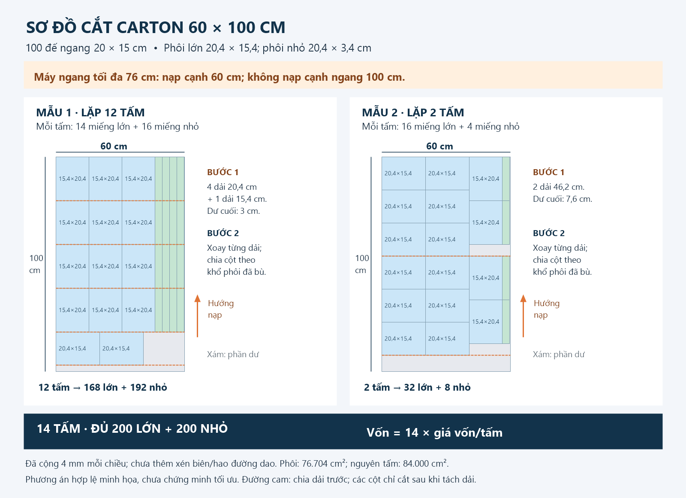
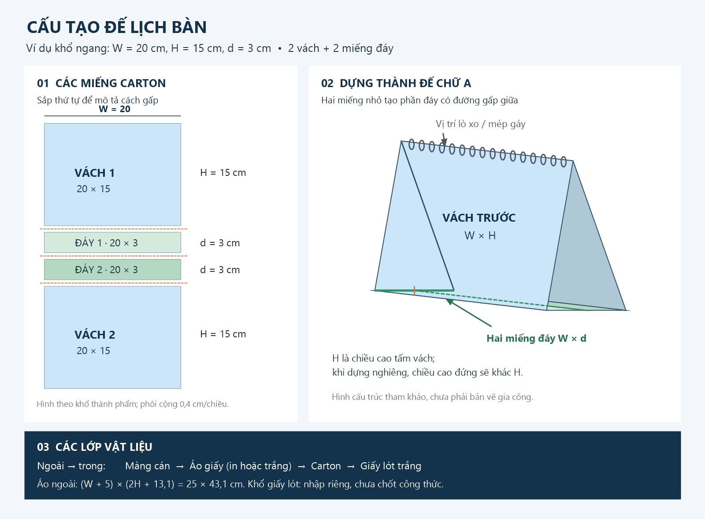

# Kế hoạch tạo module tính giá lịch bàn

Ngày lập: 25/09/2026.

Cập nhật cùng ngày: bổ sung áo bọc ngoài, giấy lót trong, toàn bộ thông số chỉnh được, giá vốn và giá báo khách theo bậc thang.

Cập nhật 26/09/2026: vốn carton tính theo số tấm nguyên **60 × 100 cm** từ sơ đồ cắt; máy có khổ ngang tối đa **76 cm**, đưa cạnh **60 cm** vào máy để chia chiều dài **100 cm**. Bổ sung hình sơ đồ cắt và cấu tạo đế tại mục 4.8.

Bổ sung sai số cắt: mỗi chiều miếng carton tăng **tổng cộng 4 mm = 0,4 cm** trước khi xếp, đúng ví dụ người dùng: **(A+0,4)×(B+0,4) cm**, không phải cộng 4 mm ở cả hai đầu thành +8 mm. Tham số này chỉnh được trong cài đặt.

Cập nhật 02/10/2026: **khổ tấm carton chuyển vào từng loại carton** (`materials.carton[i].w/h`); 60 × 100 cm nay chỉ là giá trị mặc định của loại đầu tiên, mỗi loại khai khổ riêng trong Cài Đặt → Bảng giá carton lạnh. Khổ ngang máy 76 cm và quy tắc cạnh nạp giữ nguyên, nhưng được kiểm tra theo **từng loại**. Bảng giá carton có thêm hai cột chỉ đọc để đối chiếu: Vốn/cm² tấm nguyên và tỉ lệ Khách/Vốn. Bảng giá lưu trước đó tự nâng hình dạng khi đọc, giá không đổi.

Bổ sung ép kim đế lịch: dùng chung `calculateFoilStamping` và `printConfig.EP_KIM_CONFIG` của **In KTS khổ nhỏ**; giá và cài đặt ép kim chỉ quản lý tại KTS, không lập bảng giá ép kim riêng trong module lịch.

Trạng thái: kế hoạch để triển khai; chưa lập trình module, chưa thay đổi bảng giá đang sử dụng.

## 1. Mục tiêu và phạm vi

Tạo module **Tính giá lịch bàn** gồm ba phần: **tờ lịch in + lò xo + đế lịch**. Phần tờ lịch dùng trực tiếp bộ tính giá sản phẩm của module **In KTS khổ nhỏ**; giá lò xo và đế được nhập riêng trong cài đặt module lịch bàn.

Phần **đế hoàn chỉnh** được tách thành **carton lạnh + giấy áo ngoài + cán áo + in áo (nếu có) + giấy lót trong + công bồi/ráp nếu tính riêng + ép kim đế (nếu có)**. Mỗi khoản có giá vốn và giá báo khách; không dùng giá đế đã bao gồm giấy bọc/lót rồi cộng hai khoản này lần nữa. Riêng ép kim kế thừa cách phân loại chi phí/giá của KTS hiện tại, xem mục 4.9.

Yêu cầu đã xác định từ người dùng:

- Nhập số cuốn và số tờ lịch trên một cuốn; chọn in 1 mặt hoặc 2 mặt.
- Chọn khổ đứng hoặc khổ ngang để xác định chiều ngang lịch.
- Nhập kích thước đế A × B, tính vật tư carton lạnh gồm **2 tấm A × B và 2 tấm chiều ngang × 3 cm**.
- Đế tính tiền theo cm², có ô nhập đơn giá và giá tối thiểu khi chỉ làm 1 đế.
- Lò xo có bảng nhập giá riêng trong cài đặt.
- Áo ngoài, khi A là chiều ngang: **(A + 5 cm) × (2B + 13,1 cm)**. Tổng quát theo hướng lịch là **(W + 5) × (2H + 13,1)**.
- Áo không in vẫn tính giấy trắng theo giá ram và tiền cán màng; áo có in cộng thêm đúng tiền in áo.
- Thêm **1 lớp giấy trắng không in lót mặt trong**; khổ lót đã chốt: **(W − 0,4) × (2H + 2,1 + 6 − 0,4) cm**, tức **(W − 0,4) × (2H + 7,7) cm**. Thông số công thức chỉnh được.
- Tất cả thông số định mức, kích thước bù, giấy, cán, giá, mức tối thiểu và bậc số lượng đều chỉnh được trong cài đặt.
- Bảng giá có hai cột độc lập **giá vốn / giá báo khách** và hỗ trợ **bậc thang**.
- Giá vốn carton = số tấm nguyên thực sự cần theo phương án cắt × giá vốn/tấm nguyên; giá báo khách theo cm² và bậc vẫn giữ theo yêu cầu trước, độc lập với vốn.
- Xếp carton theo khổ có bù: miếng lớn **(A+0,4)×(B+0,4)**; miếng nhỏ **(W+0,4)×(d+0,4)**, đơn vị cm. Áp dụng cho từng miếng, không chỉ cộng một lần vào tấm nguyên.
- Có sơ đồ cắt đúng trình tự máy và hình mô tả đế; các hình phải thay đổi theo kích thước, hướng lịch và định mức khi module được triển khai.
- Đế có lựa chọn ép kim; thông số đơn hàng nhập ở lịch, bộ tính và toàn bộ giá/cài đặt ép kim lấy trực tiếp từ KTS khổ nhỏ.

Phiên bản đầu phục vụ lịch bàn đóng lò xo, đế carton lạnh theo đúng cấu tạo trên. Lịch bloc, lịch treo tường, đế gỗ/mica và tạo nội dung ngày tháng tự động nằm ngoài phạm vi này.

## 2. Quy trình sản xuất và các khoản cần tính

Quy trình tham khảo từ các đơn vị trực tiếp làm lịch: chốt quy cách → thiết kế/kiểm tra file và duyệt mẫu → in tờ lịch → gia công → kiểm tra và đóng gói. Khâu đục lỗ, đóng lò xo nối các tờ thành cuốn và cho phép lật trang. Nguồn: [In ấn AZ — In lịch để bàn](https://inanaz.com.vn/in-an/in-lich-de-ban).

Phần đế chữ A có công đoạn bồi carton lạnh; sau đó đột lỗ, vào lò xo. Cán màng và ép kim là những lựa chọn gia công tùy sản phẩm. Nguồn: [Xưởng In Ánh Dương — Quy trình in lịch Tết](https://indepanhduong.com/tin-tuc-khuyen-mai/quy-trinh-in-lich-tet-chuyen-nghiep-tu-a-z-tai-xuong-in-anh-duong.html).

Ánh xạ đề xuất cho module của xưởng:

| Công đoạn | Công việc | Nơi tính chi phí |
|---|---|---|
| Chuẩn bị | Chốt khổ, số tờ, giấy, mặt in, nội dung; duyệt mẫu | Phí thiết kế/in mẫu riêng nếu có; chưa tự động thêm |
| In tờ lịch | Bình trang, in KTS 1 hoặc 2 mặt, cắt xén; cán nếu chọn | Dùng bộ tính giá KTS và cấu hình hiện hành |
| Cắt carton | Xếp đủ các miếng trên tấm 60×100, cắt với cạnh vào máy ≤76 cm | Vốn theo số tấm nguyên; giá khách theo cm² |
| Làm áo | Cắt giấy áo theo khổ trải; in nếu chọn; cán màng | Giấy theo ram + cán + in tùy chọn |
| Ép kim đế nếu chọn | Nhập vùng ép/khuôn, loại nhũ, số lần ép theo quy cách KTS | Bộ tính ép kim KTS; không tính lại giấy/cán/in áo |
| Lót và ráp đế | Thêm lớp giấy trắng bên trong; bồi, gấp và ráp | Giấy lót theo ram + công nếu tính riêng |
| Đóng cuốn | Xếp tờ theo thứ tự, đục lỗ tờ lịch và đế, luồn/ép lò xo | Bảng giá lò xo; ghi rõ có gồm công đóng hay chưa |
| Hoàn tất | Kiểm tra số tờ, chiều mặt sau, lật tờ, độ đứng; đóng gói | Ghi nhận phạm vi bao gồm; phụ phí riêng nếu phát sinh |

**Phân biệt nguồn thông tin:** công thức 4 miếng carton và nẹp rộng 3 cm là yêu cầu riêng của người dùng, không phải tiêu chuẩn chung suy ra từ các nguồn trên. Không lấy giá bán trên Internet làm giá mặc định của xưởng.

## 3. Màn hình nhập liệu

### 3.1. Thông tin chung

| Trường | Đơn vị/giá trị | Quy tắc |
|---|---|---|
| Số lượng lịch N | Cuốn | Số nguyên ≥ 1 |
| Hướng lịch | Khổ ngang / Khổ đứng | Áp dụng thống nhất cho tờ lịch và đế |
| Tên/mô tả báo giá | Văn bản | Không bắt buộc |

### 3.2. Tờ lịch

| Trường | Đơn vị/giá trị | Quy tắc |
|---|---|---|
| Số tờ L trên một cuốn | Tờ vật lý | Số nguyên ≥ 1; đã bao gồm tờ bìa nếu cùng quy cách |
| Hai cạnh tờ lịch | cm | Số dương; độc lập với kích thước đế |
| Số mặt in F | 1 hoặc 2 | Không làm thay đổi L |
| Loại giấy | Danh mục KTS | Dùng dữ liệu giấy đang có |
| Màu in | Lựa chọn KTS hỗ trợ | Dùng cùng quy tắc và giới hạn máy |
| Cán màng | Không / 1 mặt / 2 mặt | Tái sử dụng lựa chọn và giá KTS nếu đưa vào phiên bản đầu |
| Số mẫu tờ khác nhau | Mặc định L | Tham số nhiều nội dung của KTS, xem mục 5 |

Ghi chú cạnh ô số tờ: **“Nhập số tờ giấy thực tế, không nhập số trang. Ví dụ: 7 tờ in 2 mặt = 14 mặt in.”** Không tự chia đôi số tờ khi chuyển sang in 2 mặt, không tự thêm 2 tờ bìa như module sổ lò xo.

Phiên bản đầu tính một nhóm tờ cùng khổ, giấy và chế độ in. Bìa khác giấy hoặc có nhóm tờ in 1 mặt xen nhóm 2 mặt sẽ là phần mở rộng; không báo giá bằng một cấu hình chung nếu thực tế khác nhau.

### 3.3. Đế lịch

- Nhập **cạnh A (cm)** và **cạnh B (cm)** của mỗi tấm lớn làm đế.
- Có thể sao chép kích thước tờ lịch sang đế để nhập nhanh, nhưng vẫn cho sửa riêng.
- Không mặc định tờ lịch và đế luôn bằng nhau; không tự cộng chiều cao đế khi chưa có quy tắc của xưởng.
- Hiển thị ngay chiều ngang W, chiều cao H, danh sách 4 tấm và tổng diện tích carton.
- Hiển thị thêm số tấm nguyên 60×100, từng mẫu sơ đồ và số lần lặp, số miếng thu được/dư, phần dư diện tích, hướng nạp máy và thứ tự cắt; giá vốn lấy từ phương án này.
- Bề rộng hai tấm nhỏ mặc định **3 cm**, chỉnh được trong cài đặt; số tấm lớn/nhỏ mặc định 2/2 cũng là định mức cấu hình.

### 3.4. Lò xo

- Chọn loại/quy cách lò xo từ bảng cài đặt.
- Hiển thị chiều ngang đóng gáy để người dùng chọn đúng quy cách.
- Phiên bản đầu: một bộ lò xo cho mỗi cuốn, đơn giá theo bộ/cuốn. Bộ có thể gồm các đoạn lò xo theo quy cách xưởng.
- Đề xuất cho phép khai báo chiều ngang tối đa của mỗi quy cách; quá giới hạn thì yêu cầu chọn loại phù hợp. Chiều dài lò xo thực tế có thể ngắn hơn chiều ngang lịch nên không tự đồng nhất hai số này.

### 3.5. Áo ngoài và lớp lót trong

**Nhập mỹ thuật như KTS:** ở ngay từng mục áo/lót, khi chọn mỹ thuật thì có chọn khổ từ `ART_PAPER_LARGE_SHEET_SIZES` (mặc định 79×109, 72×102, 70×100 cm) hoặc **Tùy chọn** để nhập rộng/dài; luôn có ô **Giá 1 tờ giấy mỹ thuật** tính theo tờ nguyên đúng khổ chọn. Mỗi mục giữ riêng khổ và giá đang dùng, không cần sang cài đặt để nhập. Danh mục loại mỹ thuật có thể dùng làm mẫu điền nhanh; các ô trực tiếp của áo/lót quyết định giá đơn đang tính. Nút dùng giấy áo cho lót sao chép cả loại, lựa chọn khổ, rộng/dài và giá tại thời điểm bấm; sửa riêng sau đó không đổi bên kia. Đổi khổ không tự suy giá/tờ theo diện tích: người dùng nhập giá đúng khổ. Thiếu giá, giá không dương, khổ không dương hoặc không lọt phôi phải báo rõ, không lấy giá/khổ cũ hay giá ram thay thế.

**Giao diện tách hai mục trên màn quy cách:** “Giấy áo ngoài” và “Giấy lót trong”, mỗi mục có nguồn giấy, loại giấy và khổ nguyên riêng. Áo có thể chọn/in mỹ thuật; lót chọn một loại giấy ram trong bảng KTS, mỹ thuật khác hoặc chính loại mỹ thuật của áo. Không dùng một lựa chọn giấy chung ép cả hai giống nhau. Danh mục mỹ thuật dùng chung để có thể chọn cùng một vật tư, nhưng hai lựa chọn lưu độc lập. Có nút “Dùng giấy mỹ thuật của áo” ở mục lót: chọn cùng loại tại thời điểm bấm, không tự đổi lót theo các lần đổi lựa chọn áo sau đó. Khổ lót/áo vẫn tính riêng; dùng chung giấy không có nghĩa dùng chung khổ thành phẩm hoặc tự ghép tiết kiệm vật tư.

- Hiển thị khổ áo tự tính theo W/H của **đế**, không lấy kích thước tờ lịch nếu hai phần khác nhau.
- Chọn giấy áo theo ram, khổ giấy nguyên, **Không in / Có in**, loại màng và số mặt cán. Mặc định đề xuất cán 1 mặt; cấu hình được số mặt và loại màng. Chế độ không in vẫn có cán, không tự tắt cán.
- Có in: mặc định đề xuất in 1 mặt ngoài; thông số màu, mặt in, bù xén và bảng giá chỉnh trong cài đặt.
- Lót trong: mặc định 1 lớp giấy không in, không cán; chọn ram KTS hoặc mỹ thuật riêng, tự tính khổ theo W/H và công thức tại mục 4.7. Hiển thị kích thước chỉ đọc ở quy cách; sửa hệ số/phần cộng/trừ trong cài đặt. Không tự cộng tiền in/cán cho lót.
- Định mức mặc định 1 áo/đế và 1 lớp lót/đế; có thể chỉnh định mức trong cài đặt. Khổ lót tính ra không dương hoặc không lọt giấy đã chọn thì báo lỗi, chưa xuất tổng hoàn chỉnh.
- Kết quả nội bộ có cột giá vốn và giá báo khách cho từng phần; bản sao chép gửi khách chỉ chứa giá báo khách.

### 3.6. Ép kim đế lịch

- Chọn **Không ép kim / Có ép kim**, mặc định không; độc lập với lựa chọn có in áo. Áo trắng không in vẫn có thể ép kim.
- Khi bật, nhập danh sách khuôn giống KTS: rộng/cao vùng ép (cm), nhũ thường/đặc biệt, số lần ép trên mỗi đế cho từng khuôn; cho thêm/xóa khuôn.
- Số lượng sản phẩm ép mặc định chính là **N đế**, không phải N×L tờ lịch hay số tấm carton nguyên. Một khuôn ép nhiều vị trí dùng số lần ép, không nhân N trước rồi lại nhân số lần ép.
- Hiển thị nguồn giá **“Dùng giá ép kim In KTS khổ nhỏ”**. Có nút đến phần cài đặt ép kim KTS cho người có quyền; trong lịch không có ô sửa đơn giá ép kim.
- Thông số khuôn là thông tin đơn hàng; giá công, khuôn, phí vận chuyển khuôn, sàn và hệ số thuộc cấu hình dùng chung KTS.

## 4. Công thức đế lịch

Tất cả kích thước trong công thức là **cm**, diện tích là **cm²**, tiền là **đồng**.

### 4.1. Xác định ngang/dọc

```text
Khổ ngang: W = max(A, B), H = min(A, B)
Khổ đứng:  W = min(A, B), H = max(A, B)
```

Nếu A > B: khổ ngang lấy W = A; khổ đứng lấy W = B, đúng mô tả người dùng. Nếu A < B vẫn xử lý đúng bằng min/max. Nếu A = B, hai lựa chọn cho cùng kết quả diện tích.

Đổi hướng lịch làm đổi cạnh của hai tấm nhỏ; không chỉ xoay hình minh họa. Xoay tờ để bình trên máy in không được làm đổi hướng lịch đã chọn.

### 4.2. Bảng vật tư một đế

| Vật tư | Số tấm | Kích thước mỗi tấm | Tổng diện tích |
|---|---:|---|---:|
| Tấm lớn | nL, mặc định 2 | A × B | nL × A × B |
| Tấm nhỏ | nS, mặc định 2 | W × d, d mặc định 3 cm | nS × W × d |
| Tổng | nL + nS | | **S = nL × A × B + nS × W × d** |

```text
Diện tích một đế: S = nL × A × B + nS × W × d
Với mặc định nL=2, nS=2, d=3: S = 2AB + 6W
Diện tích cả đơn: S_total = S × N
Số tấm lớn cả đơn = nL × N
Số tấm nhỏ cả đơn = nS × N
```

Đây là tổng diện tích các miếng carton cấu thành; chưa phải diện tích áo/lót hay diện tích carton nguyên tấm phải mua. Áo và lót có khổ riêng ở mục 4.5–4.7. Không tự cộng mép bọc vào S; nếu dùng hao hụt carton thì khai báo thành định mức riêng và trình bày tách biệt.

S là diện tích **thành phẩm** để giữ cơ sở giá khách hiện có. Xếp cắt và tính số tấm dùng diện tích phôi có bù riêng: `S_phôi = nL×(A+c)×(B+c) + nS×(W+c)×(d+c)`, với `c=0,4 cm`. Không lấy S thay S_phôi khi kiểm tra khả năng xếp. Phần bù carton không tự cộng sang kích thước đế hoàn thiện, công thức áo hoặc lớp lót.

### 4.3. Giá đế và mức tối thiểu

Gọi R là **giá báo khách** phần carton/đế theo diện tích (đ/cm²), M là mức tối thiểu báo khách tương ứng (đ). Dòng giá này không bao gồm giấy áo, cán áo, in áo và giấy lót. Tra R theo bậc số cuốn N. **Giá vốn không còn tính bằng cm²**: dùng số tấm nguyên từ sơ đồ cắt và giá vốn/tấm tại mục 4.8. Mức tối thiểu bán không làm thay đổi số tấm hoặc vốn vật tư; công cắt/bồi nếu có phải là chi phí riêng hoặc khoản đã khai báo bao gồm.

**Quy tắc dự kiến cho phiên bản đầu, bám sát câu “nếu chỉ làm 1 đế lịch”:**

```text
Giá đế theo diện tích = S × N × R
Nếu N = 1: Tổng tiền đế = max(S × R, M)
Nếu N > 1: Tổng tiền đế = S × N × R
Phần bù tối thiểu = Tổng tiền đế − Giá đế theo diện tích
```

Không lấy M cộng thêm vào giá diện tích. Không tự nhân M với mọi đế.

Điểm cần chốt trước khi lập trình: M thực sự chỉ áp dụng khi N = 1, hay là mức tối thiểu cho cả đơn đế? Nếu là mức tối thiểu cả đơn, công thức sẽ là `max(S × N × R, M)` với mọi N. Hai cách có hành vi khác nhau; kế hoạch hiện chọn cách thứ nhất và chưa coi cách thứ hai là yêu cầu đã duyệt. Với cách thứ nhất, tổng tiền 2 đế có thể thấp hơn 1 đế nếu M lớn; phải hiển thị minh bạch, không âm thầm đổi công thức.

Thêm cấu hình **phạm vi mức tối thiểu**: `phần carton` hoặc `đế hoàn chỉnh`. Công thức và ví dụ mục này đang dùng `phần carton`. Nếu chọn `đế hoàn chỉnh`, cộng carton + áo + cán + in áo + lót + công trước, rồi áp M một lần trên tổng đó; bỏ mức sàn riêng cho carton. Cấu hình riêng điều kiện `chỉ 1 đế` hoặc `mọi số lượng`. Không áp cả hai mức sàn cùng lúc.

Quy tắc sàn ở mục này áp cho **giá báo khách**. Vốn vật tư carton luôn giữ phép tính tấm nguyên; không đặt mức sàn vốn vật tư làm mất khả năng đối chiếu lượng mua thực tế.

Khi có ép kim, đề xuất áp sàn đế cho phần đế cơ bản (carton/áo/cán/in áo/lót/công), rồi cộng riêng kết quả ép kim KTS. Bộ tính ép kim đã có mức tối thiểu riêng theo khuôn; không áp sàn đế lần nữa lên khoản ép kim hoặc để sàn đế hấp thụ mất chi phí ép kim.

### 4.4. Ví dụ kiểm tra

Cho A = 20 cm, B = 15 cm:

| Hướng | W | Hai tấm lớn | Hai tấm nhỏ | Diện tích một đế |
|---|---:|---:|---:|---:|
| Ngang | 20 | 2 × 20 × 15 = 600 | 2 × 20 × 3 = 120 | **720 cm²** |
| Đứng | 15 | 2 × 20 × 15 = 600 | 2 × 15 × 3 = 90 | **690 cm²** |

Với R = 10 đ/cm², M = 10.000 đ **chỉ là số minh họa để kiểm thử**, không phải bảng giá mặc định:

- Một đế ngang: `max(720 × 10, 10.000) = 10.000 đ`.
- Một đế đứng: `max(690 × 10, 10.000) = 10.000 đ`.
- 100 đế ngang: `720 × 100 × 10 = 720.000 đ`.
- 100 đế đứng: `690 × 100 × 10 = 690.000 đ`.

Các ví dụ trên chỉ là **giá báo khách phần carton**, chưa cộng áo/lót và gia công; không phải ví dụ giá vốn carton.

### 4.5. Công thức áo ngoài theo hướng lịch

```text
W, H = chiều ngang, chiều cao đế sau khi chọn hướng
Khổ áo: U = W + bù_ngang; V = hệ_số_cao × H + bù_dọc
Mặc định: bù_ngang=5 cm; hệ_số_cao=2; bù_dọc=13,1 cm
Diện tích áo thành phẩm = U × V
Số áo cần = N × số_áo_mỗi_đế (mặc định 1)
```

| Trường hợp | Khổ áo với thông số mặc định |
|---|---|
| A>B, khổ ngang, W=A | **(A+5) × (2B+13,1) cm** — đúng công thức người dùng |
| A>B, khổ đứng, W=B | **(B+5) × (2A+13,1) cm** — suy rộng theo cùng quy tắc W/H |
| A<B hoặc A=B | Áp W/H ở mục 4.1 rồi tính công thức tổng quát |

Ví dụ A=20, B=15: áo khổ ngang **25 × 43,1 cm**, diện tích **1.077,5 cm²**; áo khổ đứng **20 × 53,1 cm**, diện tích **1.062 cm²**. Không dùng S của carton thay diện tích áo.

Các giá trị 5; 2; 13,1 là thông số mặc định, không hardcode trong bộ tính. Chưa có quy tắc liên kết 13,1 với d=3 nên chỉnh d không tự sửa 13,1; hiển thị cả hai để quản trị điều chỉnh phù hợp. Phần bù 5/13,1 là quy cách áo, không tự xem là bleed in; bù xén in/cắt nếu có phải là trường riêng, tránh cộng hai lần.

### 4.6. Giấy áo theo giá ram, cán màng và in tùy chọn

**Giấy trắng phải được tính độc lập với tiền in.** Dù không in vẫn có vật tư giấy và cán màng. Không gọi báo giá KTS trọn gói rồi coi đó là tiền giấy trắng.

Cập nhật: giấy áo và giấy lót chọn nguồn độc lập: **giấy ram KTS** hoặc **giấy mỹ thuật có giá/khổ riêng**. Giấy ram dùng `PAPER_STOCK_DATA[].pricePerReam` và hàm `largeSheetPrice` tại `src/modules/small-print/engine/paper.js` **chỉ để tính giá vốn**; không coi giá ram là giá bán. Không ghi đè giá ram KTS tại lịch. Giấy mỹ thuật có danh mục thêm/sửa/xóa loại, tên, khổ tờ nguyên và giá vốn/tờ nguyên; chọn riêng cho áo/lót. Vốn mỹ thuật = số tờ nguyên thực dùng × giá vốn/tờ đúng khổ, không quy đổi theo ram KTS. Giá 5.000 đ/tờ 70×100 trong demo chỉ là ví dụ. Cấu hình lề cắt, khe dao, xoay và hao hụt của lịch vẫn riêng nếu áp dụng.

KTS hiện quy đổi ram gốc 500 tờ theo `STANDARD_LARGE_SHEET_SIZES[0]` (mặc định 65×86 cm); quy tắc này chỉ áp dụng cho giấy ram. Bỏ hoàn toàn tỷ lệ cộng giá chung áo/lót của demo trước. Giấy lót có quy tắc bán riêng đã chốt: **vốn giấy lót × 2, cộng vào giá đế, không theo bậc**. Giá áo có in dùng bộ tính KTS theo vùng in và màu in; phạm vi giấy/in/cán cần được thể hiện rõ, không cộng trùng.

```text
Q_áo = N × định_mức_áo
Q_cần_cắt = ceil(Q_áo × (1 + hao_hụt%/100)) + số_áo_bù
Y_áo = số áo cắt được trên một tờ nguyên theo phương án hợp lệ
T_áo = ceil(Q_cần_cắt / Y_áo)
Giá một tờ nguyên = giá_ram / K
Tiền giấy áo = T_áo × giá một tờ nguyên
```

Giá vốn giấy ram dùng công thức trên với nguồn KTS; không làm tròn lên nguyên ram. Giá một tờ nguyên quy đổi khổ bằng `largeSheetPrice`, không lấy giá ram 65×86 áp thẳng cho 79×109. Giấy mỹ thuật dùng số tờ nguyên làm tròn × giá vốn/tờ riêng. Không dùng giá vốn giấy làm giá khách tự động; áp đúng quy tắc bán riêng cho áo/lót. Không cộng lại tiền giấy nếu đã lấy tổng KTS chứa giấy.

Số áo/tờ lấy từ sơ đồ cắt thực tế với khổ đã bù xén, lề và khe cắt; không lấy `floor(diện tích tờ / diện tích áo)`. Với áo có in phải kiểm tra thêm vùng in máy và khổ cán, làm tròn theo tờ sản xuất. Khi đổi chế độ in buộc đổi khổ nguyên/sơ đồ cắt, trình bày rõ phần giấy/cán thay đổi; không chỉ cộng một phí in bất chấp phương án không phù hợp.

**Cán áo:** mặc định đề xuất 1 mặt; cài loại màng, số mặt, đơn vị tính (đ/tờ cán hoặc đ/m²), bậc số lượng và mức tối thiểu riêng cho vốn/khách. Theo đ/m²: `tiền cán = diện tích thực tế đưa qua máy cán (cm²)/10.000 × số mặt cán × đơn giá`. Theo đ/tờ: `tiền cán = số tờ thực tế đưa qua máy × số mặt cán × đơn giá`. Chỉ áp một đơn vị ở mỗi cấu hình; ghi rõ cán tờ lớn, tờ cắt hay từng áo để lấy đúng diện tích/số tờ. Áp mức tối thiểu nếu được cấu hình.

```text
Áo không in = Giấy áo theo ram + Cán áo
Áo có in    = Giấy áo theo ram + Cán áo + Tiền in áo
```

**In áo — cập nhật vùng in đã chốt:** chừa 5 mm ở cả bốn mép giấy áo. Với khổ áo U×V, vùng in là `(U−2×0,5) × (V−2×0,5) cm`. Ví dụ 25×43,1 → **24×42,1 cm**. Chọn in màu (`4color`) hoặc đen trắng (`1color`), nhập vùng in này vào bộ tính KTS khổ nhỏ như một sản phẩm, số lượng=N×số áo/đế, in 1 mặt. Giá theo bảng KTS và đúng loại giấy; mỹ thuật truyền khổ nguyên và giá/tờ riêng cho nhánh giấy tùy chỉnh. Mép trắng có cài đặt riêng, không dùng phần bù cắt carton/lót.

Tách khổ dùng **tra giá khách** khỏi khổ dùng **tính vật tư/sản xuất**: số giấy nguyên và vốn giấy phải chứa đủ áo U×V, không dùng vùng in nhỏ hơn để suy ra tiết kiệm giấy. Vốn in/cán theo phương án chứa đủ áo. Trước mắt demo giữ tiền in KTS ở dòng riêng, còn giá khách giấy áo và tổng khách để trạng thái **chờ chốt**: đang hỏi người dùng giá KTS lấy trọn giấy+in hay chỉ tiền in, và quy tắc áo không in. Không gán giấy miễn phí hoặc tự áp hệ số ×2 cho áo. Khi đã chốt, nếu lấy tổng KTS chứa giấy/cán thì không cộng lại khoản đó; nếu chỉ lấy tiền in thì phải có quy tắc bán giấy riêng. Không truyền số mặt in 0 qua KTS: áo không in bỏ qua nhánh in hoàn toàn.

Mã hiện tại `small-print/engine/paper.js` có `largeSheetPrice`, nhưng đang chia cố định 500 và dùng khổ gốc đầu danh sách. Khi hỗ trợ K sửa được, cần hàm kết nối giấy cho lịch hoặc mở rộng tương thích với mặc định 500; không sửa âm thầm công thức của các module cũ. Nhánh giấy trắng phải báo thiếu giá, không kế thừa hành vi trả 0 khi thiếu cấu hình.

### 4.7. Lớp giấy lót mặt trong

- Mặc định **1 lớp/đế**, giấy không in, không cán. Chọn giấy và khổ nguyên độc lập với áo: ram KTS hoặc mỹ thuật riêng. “Giấy trắng” ở đây là giấy chưa in, không loại trừ giấy mỹ thuật.
- Công thức người dùng đã cung cấp khi A là chiều ngang: `(A − 4 mm) × ((2B + 2,1 cm + 6 cm) − 4 mm)`. Chuẩn hóa theo hướng lịch thành `U_lót = W − 0,4 cm`, `V_lót = 2H + 2,1 + 6 − 0,4 cm = 2H + 7,7 cm`. Trừ **4 mm tổng cho mỗi chiều**, không trừ 4 mm ở cả hai đầu thành 8 mm.
- Khi B là chiều ngang: `(B − 0,4) × (2A + 7,7) cm`. Với A=20, B=15: khổ ngang cho lót **19,6×37,7 cm**; khổ đứng cho lót **14,6×47,7 cm**. Số lượng `Q_lót = N × số_lớp_lót`.
- Cài riêng hệ số nhân H=2, phần cộng dọc=2,1 cm, phần cộng đáy=6 cm, phần trừ ngang=4 mm và phần trừ dọc=4 mm. Phần trừ giấy lót độc lập với phần cộng bù cắt carton=4 mm. Chưa tự liên kết số 6 cm với 2×bề rộng miếng đáy 3 cm; thay thông số carton không âm thầm đổi công thức lót. Không lấy công thức áo ngoài thay công thức lót.
- Tính giấy lót giống cách giấy áo theo ram: sơ đồ cắt → số tờ nguyên làm tròn → giá/tờ → tiền vốn và tiền khách; áp hao hụt lót riêng nếu có.
- Giá khách lót = **tổng vốn lót × 2**, cộng đúng một lần vào tổng giá đế. Không dùng bậc lò xo/carton/cán hoặc bậc số cuốn cho lót. Hệ số mặc định 2 có cài đặt riêng theo yêu cầu toàn bộ thông số chỉnh được. Đổi nguồn/khổ/giá vốn giấy phải cập nhật cả vốn và giá khách lót. Dòng chi tiết lót là thành phần của tổng phụ đế; không cộng tổng phụ đế vào tổng đơn thêm lần nữa.
- Kiểm tra hệ số và kích thước lót tính ra hợp lệ, cập nhật sơ đồ giấy/số tờ/chi phí khi đổi A/B, hướng lịch hoặc thông số lót. Bỏ dữ liệu khổ giả lập 19,5×35,5 và ô xác nhận khổ lót của demo cũ; khôi phục trạng thái cũ phải tính lại từ công thức đã chốt.
- Mặc định tính áo và lót ở hai lượt cắt riêng. Nếu cùng giấy và muốn ghép chung để tận dụng phần dư, chỉ cộng tiết kiệm sau khi có sơ đồ ghép chung hợp lệ; không cộng hai phép chia diện tích để suy ra số tờ.

### 4.8. Xếp cắt carton nguyên tấm và tính giá vốn

#### 4.8.1. Đầu vào và giới hạn máy

| Thông số | Mặc định/nguồn | Ý nghĩa |
|---|---|---|
| Khổ carton nguyên | **Khai riêng cho từng loại carton**, mặc định **60 × 100 cm** | Vật tư đầu vào thực tế do người dùng xác định; loại đang chọn quyết định sơ đồ cắt |
| Khổ ngang tối đa của máy cắt | **76 cm** | Giới hạn cạnh nằm ngang khi đưa vật tư vào máy |
| Hướng nạp tấm nguyên | **Cạnh 60 cm ngang dao; chiều 100 cm đưa sâu vào máy** | Không xoay tấm nguyên để đưa cạnh 100 vào ngang dao |
| Miếng lớn | nL×N miếng A×B | Mặc định nL=2 |
| Miếng nhỏ | nS×N miếng W×d | Mặc định nS=2, d=3 cm |
| Bù sai số mỗi chiều | **4 mm = 0,4 cm** | Khổ phôi lớn (A+c)×(B+c), nhỏ (W+c)×(d+c); cộng một lần vào mỗi chiều |
| Xén biên, hao đường cắt | Cấu hình riêng, không tự suy ra | Ví dụ hình dùng 0 để minh họa; sản xuất dùng số xưởng nhập |
| Hướng vật liệu | Cho phép/không cho phép xoay miếng | Xoay miếng trong sơ đồ khác với xoay tấm nguyên vào máy |
| Dự phòng hỏng | % và số miếng bù theo từng loại | Cộng vào nhu cầu trước khi xếp, không cộng hao hụt hai lần |
| Giá vốn nguyên tấm | đ/tấm theo khổ của loại đó, có bậc | Không lấy đơn giá cm² thay cho giá này. Cột Vốn/cm² trong bảng giá chỉ để đối chiếu, tính trên cm² tấm nguyên nên chưa gồm hao cắt |

Tất cả giá trị mặc định trên sửa được trong cài đặt, nhưng phương án phải luôn thỏa giới hạn máy đang lưu. Với cấu hình hiện tại, chỉ hướng nạp 60 là hợp lệ. Khả năng kẹp/cắt hẹp, chiều sâu hữu dụng, chiều cao chồng và yêu cầu thao tác khác nếu cần phải bổ sung từ thông số thực tế; việc cạnh nạp ≤76 chưa tự bảo đảm mọi thao tác đều phù hợp máy.

#### 4.8.2. Cách lập phương án

1. Từ N, hướng lịch và định mức, lập nhu cầu hai loại miếng, cộng số miếng dự phòng nếu cấu hình. Đổi bù sai số 4 mm sang 0,4 cm và tính **khổ phôi cho từng miếng** trước mọi bước xoay/xếp. Giữ cả khổ thành phẩm và khổ phôi; không cộng +0,4 hai lần hoặc làm tròn xuống.
2. Trừ xén biên, xét hao đường cắt và quyền xoay miếng. Sinh cả phương án cùng loại và phối hợp miếng lớn/nhỏ trên một tấm để tận dụng phần dư.
3. Chỉ nhận sơ đồ có thể cắt bằng các đường thẳng đi hết phần vật tư đang cắt (cắt guillotine). Mỗi nhát có phần cha, cạnh nạp, vị trí cắt và các phần con; không chỉ vẽ các hình chữ nhật vừa diện tích.
4. **Nhát chia tấm nguyên đi ngang bề rộng 60**, chia chiều dài 100 thành các dải/khối. Sau khi tách rời, được xoay dải/khối để cắt tiếp nếu cạnh nạp mới ≤76. Ví dụ dải 60×20 xoay để cạnh 20 vào máy là hợp lệ; tấm 60×100 xoay cạnh 100 vào máy là không hợp lệ.
5. Chọn số lần dùng từng mẫu sao cho đủ cả hai loại miếng, kể cả tấm cuối chưa đầy. Ưu tiên ít tấm nguyên; sau đó ít miếng dư và ít thao tác. Không bắt buộc mỗi tấm phải có đủ bộ làm một đế.
6. Lưu phương án cùng tọa độ từng miếng, vùng dư, cây thứ tự cắt, số lượng mỗi loại và số lần lặp. Kiểm tra độc lập không chồng lấn, không vượt biên, đủ số lượng, đúng hướng nạp mọi bước.

Hướng triển khai: sinh các mẫu cắt dải và mẫu chia guillotine có giới hạn độ sâu; dùng quy hoạch động hoặc tìm kiếm có giới hạn để chọn tổ hợp mẫu theo nhu cầu. Luôn có phương án hợp lệ làm mốc so sánh; nếu hết thời gian tìm kiếm, trả phương án tốt nhất đã tìm được với trạng thái rõ ràng. Không hứa tối ưu toàn cục nếu chưa có bằng chứng.

`ceil(tổng diện tích phôi có bù / diện tích tấm nguyên)` chỉ là **cận dưới tham khảo**, không phải số tấm tính vốn. Chỉ gọi kết quả “tối ưu đã chứng minh” khi phương án hợp lệ đạt cận dưới (hoặc có chứng minh khác); còn lại ghi “phương án tốt nhất tìm được”. Mọi phép so sánh phải dùng cùng nhu cầu gồm phần bù đã chọn. Bù khổ miếng 4 mm, xén mép nguyên tấm, hao đường dao và số miếng dự phòng là các thông số riêng, không tự cộng trùng cho cùng một sai số.

#### 4.8.3. Giá vốn và phần dư

```text
T = tổng số tấm nguyên của các mẫu cắt đã chọn
P = giá vốn một tấm 60×100 của bậc áp dụng
Vốn vật tư carton = T × P
Vốn carton bình quân/đế = T × P / N
Diện tích nguyên tấm mua = T × 60 × 100
```

Giá vốn/tấm có hai tiêu chí bậc có thể cấu hình: theo **T tấm nguyên** (đề xuất mặc định cho mua vật tư) hoặc theo N cuốn nếu xưởng dùng bảng quy đổi đó. Nhãn đơn vị bậc phải rõ. Mặc định tìm phương án ít tấm trước, sau đó tra giá theo T; chưa tự mua thêm để hưởng bậc rẻ hơn.

Vốn này đã chứa toàn bộ diện tích dư của tấm nguyên; không nhân thêm tỷ lệ hao hụt diện tích lần nữa. Nếu tính công cắt thì tách khỏi vốn vật tư. Tách số miếng giao đủ, miếng dự phòng/dư, phế liệu đường cắt/xén và phần thừa còn dùng được. Phần thừa dùng lại được vẫn thuộc giá vốn đơn hiện tại, chưa tự trừ tiền hay chia sẻ với đơn sau khi chưa có quản lý tồn dư.

**Giá khách** vẫn dùng S×N×R và mức sàn theo mục 4.3. Hiển thị hai phép tính cạnh nhau: vốn theo tấm nguyên, khách theo cm²; hai cột có thể dùng đơn vị giá khác nhau, không ép dùng chung một đơn giá.

#### 4.8.4. Ví dụ và hình minh họa

Ví dụ quy ước: N=100 đế ngang, A=20, B=15, d=3 cm. Thành phẩm cần 200 miếng 20×15 và 200 miếng 20×3; **khổ phôi xếp cắt là 200 miếng 20,4×15,4 và 200 miếng 20,4×3,4 cm**. Cho phép xoay; ngoài bù khổ 4 mm, ví dụ chưa tính thêm xén biên, hao đường dao và miếng dự phòng.

- **Mẫu 1: lặp 12 tấm nguyên, mỗi tấm 14 lớn + 16 nhỏ.** Chia chiều 100 thành 4 dải cao 20,4 cm, 1 dải cao 15,4 cm và phần dư 3 cm. Mỗi dải 60×20,4 chứa 3 miếng lớn xoay 15,4×20,4 và 4 miếng nhỏ xoay 3,4×20,4, dùng ngang 59,8 cm. Dải 60×15,4 chứa 2 miếng lớn 20,4×15,4. Thu 168 lớn + 192 nhỏ.
- **Mẫu 2: lặp 2 tấm nguyên, mỗi tấm 16 lớn + 4 nhỏ.** Chia chiều 100 thành 2 dải 60×46,2 và dư 7,6 cm. Mỗi dải chia ngang thành các cột rộng 20,4; 20,4; 15,4; 3,4 cm (tổng 59,6). Hai cột đầu mỗi cột xếp 3 lớn cao 15,4; cột thứ ba xếp 2 lớn cao 20,4; cột cuối xếp 2 nhỏ cao 20,4. Thu 32 lớn + 8 nhỏ.
- Tổng **14 tấm**, đủ đúng **200 lớn + 200 nhỏ**. Tấm nguyên nạp cạnh 60; các dải tách rời có thể nạp cạnh 20,4; 15,4 hoặc 46,2 để chia tiếp, đều ≤76 cm.
- Diện tích thành phẩm: 72.000 cm². Diện tích phôi có bù: **76.704 cm²**. Diện tích 14 tấm: **84.000 cm²**; phần ngoài phôi **7.296 cm²**, phần bù trong phôi **4.704 cm²**. Hai phần này tách riêng, không gọi toàn bộ phần chênh là giấy còn tái sử dụng được.
- Cận dưới diện tích là 13 tấm; **14 tấm là phương án hợp lệ minh họa, chưa chứng minh tối ưu toàn cục**. Sơ đồ 12 tấm cũ không còn hợp lệ với bù 4 mm. Khi triển khai, bộ tìm kiếm có thể tìm phương án tốt hơn; số tấm báo vốn luôn lấy từ sơ đồ hợp lệ thực tế.
- Nếu giá vốn/tấm là P đồng: vốn theo phương án này = **14P**, vốn/đế = **0,14P**. Chưa có giá tấm thực tế nên không tự điền giá tiền.



Hình cấu tạo bên dưới thể hiện 2 vách W×H và 2 miếng W×d tạo phần đáy gấp, cùng áo ngoài và lớp lót. Cách gấp/lắp là minh họa cấu trúc chữ A để trao đổi, chưa phải bản vẽ gia công đã chốt khe bản lề, mép dán hoặc vị trí lỗ. Chiều cao vách H khác chiều cao đứng thực tế khi dựng nghiêng. Công thức áo vẫn là **(W+5)×(2H+13,1)**; không suy kích thước áo từ hình trải chưa có khe.



#### 4.8.5. Yêu cầu hình trong module thực tế

- Sơ đồ cắt: đúng tỷ lệ khổ 60×100; cạnh 60 đặt ngang; mũi tên nạp theo chiều 100; chú thích giới hạn máy 76. Vẽ từng ô theo **khổ phôi đã bù**, chú thích cả khổ thành phẩm và khổ phôi; đánh số nhát và tô hai màu cho hai loại miếng, màu riêng phần thừa.
- Có chọn mẫu/tấm cuối, số lần lặp mỗi mẫu, kích thước từng miếng, số lượng đạt/dư và hướng xoay khi chuyển bước. Dùng tọa độ của bộ xếp cắt thật để vẽ, không dùng ảnh minh họa cố định làm kết quả.
- Hình đế: góc nhìn khi dựng và hình các miếng rời, W/H/d, hai vách, hai miếng đáy; tùy chọn hiện áo/lót. Chọn đứng/ngang hoặc sửa định mức thì hình và giá cùng cập nhật.
- Có tải hình PNG/SVG và bản sơ đồ để in; không đưa giá vốn vào bản báo khách nếu không được chọn theo quyền nội bộ.

### 4.9. Ép kim đế dùng chung module In KTS khổ nhỏ

#### 4.9.1. Điểm kết nối đã kiểm tra trong mã nguồn

- Hàm `calculateFoilStamping(params, config)` trong `src/modules/small-print/engine/finishing.js`, được xuất qua bộ hàm KTS.
- Cấu hình duy nhất: **`printConfig.EP_KIM_CONFIG`**. Màn chỉnh là phần ép kim trong `src/components/smallprint/SettingsPanel.jsx`; không sao chép các giá này sang `calendarConfig`, không ghi đè giá ép kim riêng cho lịch.
- Hàm trả `totalCost`, `impressionPrice`, `moldCost`, `shipping`, `molds` cùng ước tính cuộn nhũ theo khuôn.

Ánh xạ dự kiến khi tính lịch:

```js
const foilResult = calculateFoilStamping(
    {
        foilStamping: params.baseFoilEnabled ? 'yes' : 'none',
        productQuantity: params.quantity, // N đế, đã kiểm tra số nguyên dương
        foilMolds: params.baseFoilMolds,  // [{ w, h, special, impressions }]
    },
    printConfig,
);
```

Gọi một lần cho **toàn bộ danh sách khuôn của đế** để giữ đúng phí vận chuyển khuôn một lần. Không gọi riêng từng khuôn rồi cộng các tổng có phí vận chuyển; không gọi lại cho từng tấm carton hoặc từng tờ lịch.

#### 4.9.2. Quy tắc giá giữ nguyên theo KTS

- KTS hiện tính diện tích khuôn có bù bằng `(w+1)×(h+1)` cm². Đây là quy tắc ép kim riêng đang có; **không cộng bù carton 0,4 cm hay bù áo 5/13,1 cm** vào w/h của vùng ép.
- Công ép áp đơn giá và mức tối thiểu theo khuôn, phân loại khuôn nhỏ/lớn, nhũ thường/đặc biệt theo KTS. Ép thêm trên cùng khuôn dùng `extraImpressionRate` từ KTS; không đặt cứng tỷ lệ trong lịch.
- Tiền khuôn tính theo các khuôn, phí vận chuyển khuôn tính một lần theo quy tắc KTS; `moldCost` đã chứa `shipping`. `totalCost` đã chứa công ép và khuôn; không cộng lại `shipping`, `moldCost` hoặc tiền nhũ ước tính bên ngoài.
- KTS hiện dùng giá theo diện tích, ngưỡng và mức tối thiểu cho ép kim; **không tự áp thêm bậc N của lịch** lên khoản này. Nếu sau này KTS thay bảng giá hoặc có bậc mới, lịch dùng cùng thay đổi đó.
- Bật ép kim mà chưa có khuôn hợp lệ hoặc thiếu `EP_KIM_CONFIG` thì báo chưa đủ thông tin, không coi việc hàm hiện trả 0/bỏ qua khuôn lỗi là báo giá hợp lệ. Mỗi khuôn cần w,h>0, số lần ép nguyên ≥1 và dữ liệu hữu hạn.

**Giá vốn và giá báo khách:** tại thời điểm kiểm tra, KTS trả một `foilResult.totalCost`, chưa có hai trường vốn/khách ép kim độc lập. `ResultPanel.jsx` dùng tổng này trong chi phí gia công, còn `quote.js` cộng tổng này vào giá khách. Để đúng yêu cầu dùng chung, lịch giữ cùng giá trị đó ở hai cột riêng của dòng ép kim, ghi rõ nguồn KTS; đây không phải giá vốn mua nhũ được xác minh độc lập. Không tự đặt tỷ lệ lãi, suy giá vốn khác hoặc tạo bảng giá lịch. Nếu cần hai bộ giá ép kim khác nhau về sau, phải bổ sung tại KTS và dùng chung, không tách nguồn giá trong lịch.

#### 4.9.3. Gộp báo giá và làm mới dữ liệu

```text
Không ép kim: khoản ép kim = 0
Có ép kim: khoản ép kim = foilResult.totalCost cho cả N đế
Tổng đế hoàn chỉnh = Tổng đế cơ bản sau quy tắc sàn + khoản ép kim
```

Khoản ép kim đã tính toàn đơn, **không nhân thêm N** khi gộp. Phần tờ lịch và phần in áo phải tắt ép kim trong lần gọi riêng của chúng, vì ép kim đế được cộng tại một dòng duy nhất. Không áp phụ thu số nội dung tờ lịch lên ép kim đế.

Kết quả hiển thị dòng **“Ép kim đế — giá KTS”**, cho mở chi tiết công ép, khuôn và phí vận chuyển nằm trong tiền khuôn. Thay N, danh sách khuôn hoặc giá KTS phải tính lại. Khi quay về từ cài đặt KTS, đọc cấu hình mới theo cơ chế làm mới có sẵn; lưu đơn lịch chỉ lưu bật/tắt và thông số khuôn, không tạo bản sao bảng giá ép kim.

## 5. Tính giá tờ lịch bằng module KTS khổ nhỏ

### 5.1. Quy đổi số lượng

```text
Tổng tờ lịch thành phẩm Q = N × L
Tổng mặt in thành phẩm = Q × F
```

Ví dụ 100 cuốn, mỗi cuốn 7 tờ, in 2 mặt: **700 tờ lịch, 1.400 mặt in**. Đầu vào số lượng sản phẩm KTS là **700**, số mặt là **2**; không truyền 1.400 rồi nhân 2 lần nữa.

### 5.2. Cách tái sử dụng

Đã kiểm tra mã hiện tại:

- `src/modules/small-print/engine/options.js`: có các hàm tìm phương án theo loại giấy `calculatePaperOptions`, `calculatePerSheetOptions`, `calculateDecalOptions`.
- `src/modules/small-print/engine/quote.js`: `calculateCustomerQuote` trả giá bán `totalCustomerCost` cùng chi tiết tiền in, cán, giấy và phụ thu.
- `src/App.jsx`: module KTS hiện chọn phương án từ danh sách hợp lệ, ưu tiên khổ có chiều cao ≤ 48 cm; phải giữ cùng quy tắc khi so sánh kết quả.
- `src/modules/spiral/engine/pricing.js`: đã có cách kết nối với bộ tính KTS, nhưng có quy tắc riêng cho bìa/ruột và A4 của sổ. Chỉ tham khảo cách kết nối, không sao chép toàn bộ công thức sổ sang lịch.

Tạo hàm kết nối cho tờ lịch với ánh xạ:

| Đầu vào KTS | Giá trị từ lịch |
|---|---|
| `productW`, `productH` | Ngang/cao tờ lịch sau khi áp hướng, tính bằng cm |
| `productQuantity` | N × L |
| `printSides` | 1 hoặc 2 |
| `paperType`, `printColorMode` | Lựa chọn giấy và màu |
| `bleed` | Cùng quy tắc bù xén với KTS; chỉ cộng một lần |
| `printContents` | Số mẫu tờ khác nhau; mặc định L, không nhân N |
| `laminationType` và loại màng | Lựa chọn cán nếu có |
| `mountingType`, `holePunchingType`, `creasingType` | Không áp cho tờ lịch ở phiên bản đầu; đế và đóng gáy tính riêng |
| `foilStamping` | Tắt trong phần tờ lịch; ép kim đế tính riêng bằng N đế, xem mục 4.9 |

Quy ước đề xuất: một mẫu tờ hai mặt là một bộ nội dung trước/sau; số mẫu tờ mặc định bằng L. Phải ghi rõ quy ước này trên giao diện và đối chiếu cách xưởng đang nhập “số nội dung” trong KTS. Không đặt cứng bằng 1 khiến phụ thu nhiều nội dung bị mất; cũng không tự nhân L × 2 mà chưa thống nhất nghiệp vụ.

Lấy `totalCustomerCost` làm tiền phần tờ lịch. Không cộng lại tiền giấy, tiền cán hay phụ thu đã nằm trong kết quả này; không lấy giá vốn `costPerProduct` thay giá bán. Không lấy giá in một cuốn rồi nhân N vì bậc giá thay đổi theo tổng số lượng.

Đồng thời lấy chi tiết chi phí giấy, in, cán và gia công thực tế của phương án KTS để tính **giá vốn tờ lịch**. Nhân theo số tờ sản xuất đã làm tròn và hao hụt nếu có; không chỉ lấy chi phí bình quân mỗi ô ghép nhân số tờ lịch rồi bỏ qua ô trống cuối. Đầu ra hàm kết nối gồm `costTotal` và `customerTotal` với cùng phương án sản xuất. Tách rõ tiền in áo riêng ở mục 4.6 và báo giá trọn phần tờ lịch ở mục này.

KTS tính số tờ máy theo số sản phẩm ghép được, có làm tròn tờ. Phải kế thừa quy tắc đó thay vì tự quy đổi bằng diện tích A4. Việc gom N × L để báo giá là cách định giá theo module KTS; lịch bình trang sản xuất phải vẫn bảo đảm mỗi nội dung đủ N bản, đúng cặp trước/sau. Không coi kết quả ghép hình học là sơ đồ sản xuất đã được kiểm chứng cho mọi bộ lịch nhiều nội dung.

Tiêu chí bắt buộc: cùng cấu hình, khổ, số tờ, số mặt và số nội dung thì **tiền tờ lịch bằng giá module KTS** cho đơn tương đương. Nếu không có phương án in hoặc thiếu cấu hình giấy/bậc giá, báo lỗi rõ và không xuất tổng giá hoàn chỉnh.

## 6. Bảng cài đặt giá lịch bàn

### 6.1. Bảng lò xo

Cấu trúc đề xuất; các đơn giá do quản trị nhập:

| Cột | Ý nghĩa |
|---|---|
| Mã và tên quy cách | Ví dụ loại, màu, cỡ lò xo; không hardcode giá |
| Chiều ngang áp dụng tối đa (cm) | Tùy chọn để kiểm tra phù hợp với gáy |
| Từ số cuốn / Đến số cuốn | Bậc số lượng, biên bao gồm |
| Giá vốn (đ/bộ/cuốn) | Chi phí một bộ lò xo cho một cuốn |
| Giá báo khách (đ/bộ/cuốn) | Giá bán độc lập cho cùng quy cách và bậc |
| Bao gồm công đóng | Ghi rõ có gồm xếp tờ, đục lỗ và đóng lò xo |
| Đang sử dụng | Bật/tắt quy cách |

```text
Chọn bậc theo N và loại lò xo
Số bộ lò xo = N × định mức bộ/cuốn (mặc định 1, sửa được)
Vốn lò xo = số bộ × giá vốn của bậc
Giá khách lò xo = số bộ × giá khách của bậc
```

Một dòng từ 1 đến không giới hạn là đủ cho xưởng dùng giá cố định. Nếu nhập nhiều bậc, không được trùng hoặc bỏ hở khoảng; không tìm thấy đúng một bậc thì báo thiếu cấu hình, không tự lấy giá 0. Nếu sau này xưởng muốn tính theo cm chiều dài lò xo, bổ sung chế độ riêng, không trộn đơn vị với đ/cuốn.

### 6.2. Bảng đế

| Trường | Đơn vị | Yêu cầu |
|---|---|---|
| Tên/quy cách đế | Văn bản | Ghi chất liệu và độ dày nếu cần |
| Từ / Đến số cuốn | Cuốn | Chọn bậc theo N |
| Khổ carton và máy | cm; bù sai số nhập mm | Khổ tấm khai theo từng loại carton (mặc định 60×100); ngang máy 76 dùng chung; bù mỗi chiều mặc định 4 mm; hướng nạp, xén biên, hao đường cắt sửa được |
| Giá vốn carton nguyên tấm | đ/tấm theo khổ của loại đó | Tra bậc vốn theo T tấm (mặc định) hoặc N cuốn; vốn=T×P |
| Giá báo khách carton/đế | đ/cm² | R_khách ≥ 0; độc lập với giá vốn |
| Mức tối thiểu báo khách | đ | M_khách ≥ 0; không áp mức sàn bán vào vốn vật tư carton |
| Điều kiện và phạm vi tối thiểu | Lựa chọn | Chỉ 1 đế / mọi số lượng; carton / đế hoàn chỉnh |
| Phạm vi công đã gồm | Ghi chú | Xác định công cắt, keo, bồi/ráp có nằm trong dòng carton hay tính riêng |

**Thay thế đề xuất cũ về giá đế trọn gói:** vì áo và lót được tính riêng, bảng cm² không được bao gồm lại các khoản đó. Nếu bảng giá cũ là đế đã hoàn thiện, phải tách giá trước khi sử dụng cấu hình mới. Công cắt/bồi/ráp có thể đã gồm trong dòng carton hoặc có dòng riêng theo cuốn/trọn đơn; khai báo một nơi duy nhất, có giá vốn/khách và bậc tương ứng.

Nếu còn thiếu công bồi/ráp hoặc đóng lò xo, kết quả phải ghi rõ phần chưa gồm, không trình bày thành giá hoàn thiện đầy đủ.

Phân biệt giá **chưa nhập** (`null`) với giá **0 do quản trị chủ động khai báo**. Cấu hình ban đầu để trống giá bắt buộc và báo “Chưa cài đặt giá”, không dùng số minh họa để báo khách.

### 6.3. Lưu và phân quyền

- Dùng cấu hình riêng `calendarConfig`, mã module `calendar`, có phiên bản và kiểm tra cấu trúc.
- Dùng chung `printConfig` đang lưu cho giấy, máy và giá in KTS; không tạo bản sao bảng giá in.
- Ép kim đế đọc trực tiếp `printConfig.EP_KIM_CONFIG`; toàn bộ giá và cài đặt ép kim vẫn ở KTS khổ nhỏ. Không thêm bảng giá, override hoặc bản sao `EP_KIM_CONFIG` trong `calendarConfig`.
- Theo cơ chế lưu cục bộ/đồng bộ và quyền quản trị hiện có; người dùng thường chỉ xem/tính giá.
- Khi quay lại ứng dụng hoặc giá KTS thay đổi, làm mới cả hai cấu hình và tính lại kết quả.
- Lưu thất bại phải hiển thị đúng trạng thái; không thông báo đã đồng bộ khi chỉ lưu cục bộ.

### 6.4. Các nhóm thông số phải chỉnh được

| Nhóm | Thông số cấu hình |
|---|---|
| Carton | Số miếng lớn/nhỏ; d=3 cm; bù khổ mỗi chiều 4 mm; khổ tấm theo từng loại (mặc định 60×100); ngang máy 76; hướng nạp/xoay, xén/hao cắt, bù miếng; vốn/tấm nguyên; khách/cm² thành phẩm và sàn khách |
| Áo ngoài | Bù ngang 5 cm, hệ số cao 2, bù dọc 13,1 cm; số áo/đế; giấy; khổ nguyên; bù xén; hao hụt |
| Giấy lót | Số lớp mặc định 1; hệ số H=2, cộng dọc=2,1 cm, cộng đáy=6 cm, trừ ngang/dọc=4 mm mỗi chiều; giấy KTS, khổ nguyên, hao hụt |
| Giấy áo/lót | Nguồn ram KTS chỉ tính vốn hoặc mỹ thuật khổ/giá vốn theo tờ riêng; chọn độc lập, thêm được loại mỹ thuật; lót bán = vốn×2 |
| Cắt/bình giấy | Lề, khe cắt, cho phép xoay, khổ tờ sản xuất; không hardcode các giá trị ngoài mặc định |
| Cán áo | Loại màng, số mặt; đơn vị đ/tờ hoặc đ/m²; khổ/diện tích cán; vốn/khách và mức tối thiểu |
| In áo | Mặt in, màu, số nội dung, máy/khổ, giá vốn/khách và bậc kế thừa KTS hoặc ghi đè có tên rõ |
| Ép kim đế | Trong lịch chỉ nhập bật/tắt và thông số khuôn của đơn; **giá/cài đặt chỉ sửa tại In KTS khổ nhỏ** |
| Lò xo và công | Loại, định mức, giới hạn quy cách, công đã gồm; vốn/khách; đơn vị; mức sàn nếu có |
| Chung | Biên bậc, đơn vị chọn bậc, làm tròn tiền, trường mặc định, phiên bản cấu hình |

Giấy và giá in dùng chung vẫn chỉnh tại cài đặt KTS, có chỉ dẫn nguồn ngay trong cài đặt lịch. Các thông số riêng hoặc ghi đè của lịch lưu trong `calendarConfig`, không tự sửa bảng dùng chung. Các phép cộng/nhân và kiểm tra hợp lệ là quy tắc của chương trình; các con số định mức và giá không bị cố định trong mã.

Ngoại lệ rõ ràng với cơ chế ghi đè: **ép kim không cho ghi đè trong lịch**, theo yêu cầu người dùng. Thay đổi quy tắc/giá ép kim phải thực hiện ở KTS và áp dụng chung.

### 6.5. Quy tắc bậc thang và hai loại giá

Mỗi dòng bậc có `từ`, `đến`, `đơn vị xét bậc`, `đơn vị tính tiền`, `giá vốn`, `giá khách` và mức tối thiểu nếu áp dụng. Biên bậc sửa được; ví dụ 1–9, 10–49, 50–99, từ 100 chỉ để minh họa, chưa phải bảng thực tế của xưởng. **Bắt buộc có nút thêm/xóa bậc**, không đóng cứng ba bậc hay chặn mốc sau 100. Cho nhập tiếp 200, 500, 1.000…; lưu danh sách động. Trong demo nhập mốc bắt đầu; mốc kết thúc = mốc tiếp theo − 1, bậc cuối không giới hạn. Bậc đầu bắt đầu tại 1 và không xóa; phát hiện mốc trùng, giảm dần, không nguyên, đơn giá âm hoặc thiếu trước khi báo giá.

**Danh mục động:** từng nhóm carton, lò xo, cán áo và công bồi/ráp có nút **Thêm loại**, tên sửa được, chọn loại và xóa loại; mỗi loại giữ bảng bậc riêng. Thêm loại sao chép bảng đang chọn làm điểm bắt đầu, không tự giảm giá. Thêm bậc sao chép giá bậc cuối để người dùng sửa. Chuyển loại phải khôi phục đúng bảng đã nhập; xóa loại đang chọn chuyển về loại còn lại; không xóa loại cuối. Trong phần mềm thật, loại đã được báo giá sử dụng nên chuyển ngừng dùng và giữ phiên bản cũ. Giấy và ép kim là danh mục/cài đặt dùng chung KTS, không tạo bản giá riêng ở lịch; nút liên quan dẫn đến cài đặt KTS khi tích hợp. Demo chỉ giải thích và hiển thị nguồn KTS, không ghi vào phần mềm.

- Đề xuất mặc định: **giá khách carton**, cán, lò xo và công riêng chọn bậc theo số cuốn N. **Giá vốn carton nguyên tấm** chọn bậc theo T tấm cần dùng. Giấy áo/lót lấy giá ram KTS, không tạo bậc giá ram tại lịch. Mỗi cột lưu riêng tiêu chí bậc và đơn vị tính tiền; vốn đ/tấm và khách đ/cm² không dùng chung đơn vị.
- Nếu xưởng đổi tiêu chí bậc sang số tờ nguyên, số tờ cán hoặc diện tích, lưu rõ tiêu chí trong cài đặt và hiển thị lượng dùng để tra; không so N với ngưỡng tờ/m². Khi bậc giấy theo tờ, dùng số tờ cần trước làm tròn mua ram.
- Giá in tờ lịch và in áo kế thừa bậc KTS theo đại lượng KTS đang dùng (ví dụ trang A4 quy đổi); không ép chọn bậc in theo N. Mặc định là hai lượt việc riêng; chưa cộng gộp lượng in áo với tờ lịch để hưởng chung bậc.
- Ép kim kế thừa hoàn toàn giá/ngưỡng/sàn của KTS; không tạo bậc số lượng riêng hay tăng giá lần nữa tại lịch.
- Chọn đúng một bậc và áp đơn giá đó cho toàn bộ lượng tính tiền của thành phần. Đây là **giá theo bậc số lượng**, không phải chia lũy tiến từng đoạn như tiền điện.
- Bậc phải liên tục, không trùng, có bậc cuối không giới hạn; giá thiếu là lỗi cấu hình. Hai cột vốn/khách đều cần dữ liệu, không suy vốn từ giá bán hoặc ngược lại khi chưa có quy tắc.
- Với các khoản có sàn vốn/khách, áp riêng từng cột; 0 chỉ dùng khi quản trị chủ động chọn không áp sàn. **Carton vật tư ngoại lệ: vốn=T×P, không sàn vốn vật tư**; sàn bán chỉ áp giá khách. Được cảnh báo giá khách thấp hơn vốn, không tự nâng giá hoặc sửa bậc.

## 7. Kết quả báo giá

```text
Đế cơ bản = Carton + Giấy áo + Cán áo + In áo (nếu có) + Giấy lót + Công riêng
Đế hoàn chỉnh = Đế cơ bản sau quy tắc sàn + Ép kim đế (nếu có, lấy KTS)
Tổng vốn = Vốn tờ lịch + Vốn lò xo + Vốn đế hoàn chỉnh
Tổng báo khách = Giá khách tờ lịch + Giá khách lò xo + Giá khách đế hoàn chỉnh
Vốn/cuốn = Tổng vốn / N
Giá khách/cuốn = Tổng báo khách / N
Chênh lệch dự kiến = Tổng báo khách − Tổng vốn
```

Áp mức tối thiểu của đế theo phạm vi đã cấu hình trước khi gộp tổng. Các khoản dùng cùng cách hiểu thuế. Không tự cộng lợi nhuận lần nữa vào giá khách đã nhập; chưa tự thêm VAT mới. Chênh lệch là số tham khảo nội bộ, chưa phải lợi nhuận sau mọi chi phí.

Bảng kết quả cần có:

| Thành phần | Số lượng/diễn giải | Giá vốn | Giá báo khách |
|---|---|---|---|
| Tờ lịch | N × L tờ; F mặt; khổ và giấy | Chi phí KTS | Báo giá KTS |
| Lò xo | Số bộ, quy cách và bậc | Theo bậc vốn | Theo bậc khách |
| Carton | T tấm nguyên 60×100; nhu cầu miếng S×N cm²; sơ đồ cắt | **T × giá vốn/tấm** | S×N×giá khách/cm² |
| Giấy áo | Khổ U × V, số áo/tờ nguyên, số tờ nguyên | Ram KTS hoặc mỹ thuật theo tờ | Chờ chốt phạm vi giá áo KTS và quy tắc áo không in |
| Cán áo | Loại, số mặt, tờ/diện tích cán thực tế | Theo bậc vốn | Theo bậc khách |
| In áo | Không in: 0; có in: khổ, mặt, lượng in | Tiền in riêng | Tiền in riêng |
| Giấy lót | Khổ, lớp, số tờ nguyên | Ram KTS hoặc mỹ thuật theo tờ | Vốn×2, nằm trong giá đế; không bậc |
| Công riêng | Chỉ các công đoạn chưa gồm | Theo bậc vốn | Theo bậc khách |
| Ép kim đế | N đế, danh sách khuôn và số lần ép; nguồn KTS | `foilResult.totalCost` theo cách KTS hiện dùng | Cùng tổng ép kim KTS; không nhân lại N |
| Bù tối thiểu | Ghi rõ phạm vi áp dụng | Chỉ khoản có sàn vốn riêng; carton vật tư không áp | Bù khách |
| Tổng | N cuốn | Tổng vốn | Tổng báo khách |
| Giá/cuốn | Tổng chia N | Vốn/cuốn | Giá khách/cuốn |

Khi áp dụng tối thiểu đế, hiển thị giá khách trước sàn, phần bù và tiền khách cuối; vốn vật tư carton vẫn giữ T×P. Các khoản khác có sàn vốn riêng thì hiển thị tại đúng khoản đó. Dòng “Đế hoàn chỉnh” là tổng phụ, không cộng lại cùng các dòng thành phần. Chi tiết KTS cũng không cộng thêm lần nữa.

Giữ độ chính xác khi tính kích thước/diện tích và tính tiền theo quy tắc tiền tệ chung của ứng dụng. Khi làm tròn để hiển thị, phải bảo đảm tổng các dòng khớp tổng báo giá; đơn giá bình quân có thể có số lẻ và không dùng đơn giá đã làm tròn để tính ngược tổng.

Có nút sao chép báo khách cùng quy cách, số lượng, tiền khách và phạm vi bao gồm; không chứa giá vốn/chênh lệch. Quyền xem vốn dùng phân quyền hiện có, không mặc định công khai. Minh họa đế gồm carton, khổ áo, khổ lót và hướng lịch; phản ánh các định mức đã sửa.

## 8. Kế hoạch triển khai trong dự án hiện tại

### Bước 1 — Chốt quy tắc và ví dụ đối chiếu

- Xác định phạm vi mức tối thiểu đế theo mục 4.3.
- Xác định công bồi/ráp và đóng lò xo đã nằm trong khoản nào; tách áo/lót khỏi đơn giá carton.
- Áp dụng công thức lót đã chốt tại mục 4.7; xác định mặc định cán áo 1 mặt và in áo 1 mặt có phù hợp không.
- Nhập hai cột vốn/khách và biên bậc; xác định đơn vị tra bậc cho từng bảng.
- Nhập giá vốn/tấm carton 60×100; xác định xén biên, hao đường cắt và các giới hạn thao tác máy ngoài bề ngang 76. Đối chiếu sơ đồ mẫu với cách cắt của xưởng.
- Chốt đơn vị đ/cuốn cho lò xo và quy ước số nội dung KTS.
- Dùng ví dụ 20 × 15 cm, đứng/ngang, N = 1 và N = 100 làm bộ đối chiếu.
- Lấy một vài báo giá KTS từ cấu hình thực tế để kiểm tra phần tờ lịch; không tự đặt giá in.
- Đối chiếu ép kim với KTS ở cùng N và danh sách khuôn; giữ nguyên nguồn cài đặt KTS và cách phân loại chi phí hiện có.

### Bước 2 — Cấu hình và bộ tính thuần

Các file dự kiến tạo:

```text
src/modules/calendar/
  config/defaultConfig.js
  config/schema.js
  config/version.js
  config/index.js
  engine/base.js          # Hướng lịch, vật tư carton, mức tối thiểu đế
  engine/cartonLayout.js  # Xếp hai loại miếng, giới hạn máy, cây nhát cắt, số tấm
  engine/cartonCost.js    # Vốn=tấm nguyên×giá/tấm; giá khách theo cm²
  engine/wrapper.js       # Khổ áo, cán, in tùy chọn; hai cột giá
  engine/liner.js         # Khổ và lượng giấy lót, không in
  engine/paper.js         # Sơ đồ cắt, số tờ nguyên; gọi định giá ram dùng chung KTS
  engine/tiers.js         # Tra bậc theo đại lượng và mức sàn vốn/khách
  engine/coil.js          # Chọn quy cách và bậc giá lò xo
  engine/printAdapter.js  # Tờ lịch trọn phần; in áo chỉ lấy tiền in
  engine/foilAdapter.js   # Kiểm dữ liệu và gọi calculateFoilStamping với printConfig; không chép công thức/giá
  engine/pricing.js       # Gộp thành phần, vốn/khách, không cộng trùng
  engine/index.js
```

Hàm tổng dự kiến: `calculateCalendar(params, printConfig, calendarConfig)`. Bộ tính không đọc giao diện, trình duyệt hay cơ sở dữ liệu; không sửa đầu vào/cấu hình KTS. Đầu ra mỗi thành phần có khối lượng, đơn vị, bậc đã dùng, `costTotal`, `customerTotal`, phần bù sàn; tổng có vốn/khách mỗi đơn và mỗi cuốn. Nếu thiếu lót/giá, trả trạng thái chưa đầy đủ thay vì tổng hoàn chỉnh.

### Bước 3 — Giao diện

Tạo `src/components/calendar/CalendarInputPanel.jsx`, `CalendarResultPanel.jsx`, `CalendarSettingsPanel.jsx`. Thêm mục “Tính giá lịch bàn” vào màn hình chính, kết nối cấu hình, kết quả và cài đặt theo cấu trúc module hiện có.

Trong phần đế thêm lựa chọn ép kim, bộ nhập nhiều khuôn và chi tiết kết quả dùng cùng quy ước KTS. Nếu tách thành phần giao diện dùng chung, giữ hành vi KTS hiện tại; cài đặt lịch chỉ có chỉ dẫn/nút mở cài đặt ép kim KTS.

Thêm `CartonCutVisualizer.jsx` (tọa độ cắt, chọn mẫu, trình tự thao tác, tải hình) và `CalendarBaseVisualizer.jsx` (đế dựng, miếng rời, áo/lót). Hiển thị trạng thái tìm kiếm và tính hợp lệ; không gắn nhãn tối ưu khi chưa chứng minh. Hình ở mục 4.8 hiện là ví dụ tĩnh cho kế hoạch, chưa phải module đã chạy.

### Bước 4 — Tích hợp lưu giá và danh mục module

Các điểm đã thấy trong mã nguồn cần cập nhật khi triển khai:

| Điểm tích hợp | Công việc dự kiến |
|---|---|
| `src/App.jsx` | Mục trang chủ, chuyển module, tải hai cấu hình, tính lại, cài đặt, xóa cache liên quan khi cần |
| `src/config/moduleVisibilityConfig.js` | Tên, mô tả và hiển thị module mới; tương thích cấu hình cũ |
| `src/utils/configStorage.js` | Đăng ký `calendarConfig`, validation, merge mặc định, lưu/đọc và mã Supabase `calendar` |
| `src/lib/priceConfigStore.js` | Kiểm tra luồng dùng chung tải/lưu và lịch sử cấu hình |
| `src/components/admin/PriceConfigHistoryPanel.jsx` | Kiểm tra danh mục/lịch sử có nhận module mới |
| `src/components/common/useConfigRefreshOnFocus.js` | Tái sử dụng làm mới giá in và giá lịch |
| Cơ sở dữ liệu giá | Migration riêng để thêm `calendar` vào các ràng buộc module và danh sách cho phép trong hàm lưu |

Trong `docs/database/supabase-price-configs.sql` hiện có danh sách module cố định ở nhiều ràng buộc và hàm; chỉ thêm giao diện là chưa đủ để lưu giá lịch lên hệ thống. Khi triển khai cần rà toàn bộ các vị trí này, bảo toàn chính sách quyền và lịch sử. Có thay đổi chưa commit sẵn trong các file SQL ở thời điểm lập kế hoạch; không ghi đè những thay đổi đó.

### Bước 5 — Kiểm thử và nghiệm thu

- Viết kiểm thử carton theo tấm nguyên, cây nhát cắt và hướng nạp máy, số miếng đủ từng loại; áo theo hướng, giấy ram, lớp lót, cán/in tách riêng, hai cột giá, biên bậc và kết nối KTS.
- Kiểm tra giao diện đứng/ngang, thay số mặt, lưu giá, tải lại và quyền cài đặt.
- Chạy nhóm kiểm thử KTS, spiral và lưu cấu hình có liên quan để bảo đảm không đổi hành vi cũ.
- Chạy kiểm tra mã/build theo dự án; chỉ bật báo giá chính thức sau khi đã nhập đơn giá thực và đối chiếu mẫu xưởng.

## 9. Các ca kiểm thử bắt buộc

| Mã | Tình huống | Kết quả mong đợi |
|---|---|---|
| CAL-01 | A=20, B=15, ngang | W=20; S=720 cm²; 4 tấm/đế |
| CAL-02 | A=20, B=15, đứng | W=15; S=690 cm² |
| CAL-03 | A=15, B=20 | Cùng kết quả theo hướng như CAL-01/02 |
| CAL-04 | A=B=20 | Cả hai hướng S=920 cm² |
| CAL-05 | A=20,5; B=15; ngang | S=738 cm², không cắt phần thập phân |
| CAL-06 | N=1; S=720; R=10; M=10.000 | Tiền đế=10.000; bù=2.800 |
| CAL-07 | N=1; S=720; R=20; M=10.000 | Tiền đế=14.400; không cộng thêm M |
| CAL-08 | N=100; S=720; R=10 | Tiền đế=720.000; diện tích=72.000 cm² |
| CAL-09 | N=2; S=720; R=10; M=20.000 | Tiền đế=14.400 theo quy tắc tối thiểu chỉ N=1; cập nhật kỳ vọng nếu chốt chính sách khác |
| CAL-10 | N=100; L=7; F=2 | Q=700 tờ; 1.400 mặt; đầu vào KTS Q=700, F=2 |
| CAL-11 | Giữ N,L; đổi F=1 sang F=2 | Số tờ thành phẩm giữ nguyên; đế/lò xo giữ nguyên; giá in do KTS tính lại |
| CAL-12 | Cùng đầu vào với màn hình KTS | Tiền tờ lịch bằng giá bán KTS; kiểm cả phụ thu nhiều nội dung, giấy và cán |
| CAL-13 | Q không chia hết số sản phẩm/tờ máy | Làm tròn tờ máy đúng KTS; không tự làm tròn từng cuốn |
| CAL-14 | Chọn từng mô hình giá giấy được hỗ trợ | Hàm kết nối gọi đúng nhánh và không dùng nhầm đơn vị |
| CAL-15 | N tại biên hai bậc lò xo | Chọn đúng một bậc; tổng=N×đơn giá |
| CAL-16 | Thiếu/trùng bậc, quy cách lò xo không phù hợp | Có lỗi cụ thể; không trả tổng giá hoàn chỉnh |
| CAL-17 | A/B≤0, N/L không nguyên, F ngoài 1–2, giá âm/không hữu hạn | Từ chối dữ liệu sai; không tự cắt số lẻ bằng parseInt |
| CAL-18 | Chưa nhập giá bắt buộc | Báo thiếu cấu hình; không coi là giá 0 |
| CAL-19 | Khổ tờ vượt khả năng in | Báo không có phương án; không hiển thị giá cũ như kết quả mới |
| CAL-20 | Thay giá KTS hoặc giá lịch, tải lại ứng dụng | Giá mới được sử dụng đúng; không ghi đè bảng KTS bằng cấu hình lịch |
| CAL-21 | Người dùng thường mở cài đặt/ghi giá | Tuân thủ quyền quản trị hiện có ở cả giao diện và nơi lưu |
| CAL-22 | Giá khách tờ=300.000, lò xo=100.000, carton=720.000, giấy áo=50.000, cán=30.000, in áo=20.000, lót=10.000, công=40.000; N=100; không bù sàn | Tổng=1.270.000; giá/cuốn=12.700; không cộng lại tổng phụ đế |
| CAL-23 | A=20, B=15, ngang; cấu hình áo mặc định | Khổ áo=25×43,1 cm; diện tích=1.077,5 cm² |
| CAL-24 | Cùng A/B, đứng | Khổ áo=20×53,1 cm; diện tích=1.062 cm² |
| CAL-25 | Đổi bù ngang=6, bù dọc=8; ngang 20×15 | Áo=26×38 cm; đọc cài đặt mới, không còn 5/13,1 cố định |
| CAL-26 | Áo không in, giữ các cấu hình khác | Vẫn tính giấy và cán; tiền in vốn/khách=0; không chạy nhánh in |
| CAL-27 | Bật in áo, cùng phương án giấy/cán hợp lệ | Tăng đúng tiền in; không cộng lại giấy/cán; vốn và khách thay đổi riêng |
| CAL-28 | 100 lót, cắt được 4 lót/tờ nguyên, ram KTS=500.000/500 tờ gốc, hao hụt=0 | 25 tờ nguyên; giấy vốn=25.000, khách=50.000 nằm trong giá đế; không làm tròn 1 ram |
| CAL-29 | 101 lót, cùng thông số CAL-28 | 26 tờ nguyên; vốn=26.000, khách=52.000; không chọn bậc |
| CAL-30 | 25 tờ nguyên, chọn khổ khác khổ gốc KTS | Giá/tờ bằng `largeSheetPrice`; không có ô thay số tờ/ram riêng tại lịch |
| CAL-31 | Một lớp lót, khổ riêng và giá giấy riêng | Tính đúng lượng lót; tiền in/cán lót=0; không dùng khổ áo thay khổ lót |
| CAL-32 | Thiếu khổ lót hoặc giá ram nguồn KTS | Báo thiếu dữ liệu, không trả tổng hoàn chỉnh hoặc điền 0 |
| CAL-33 | N=9 và 10, hai bậc 1–9 / 10–49 | Mỗi thành phần chọn đúng bậc; cả lượng áp giá bậc, không tính lũy tiến |
| CAL-34 | Giữ giá khách, chỉ đổi giá vốn | Giá khách không đổi; vốn và chênh lệch cập nhật |
| CAL-35 | Dùng mức sàn giá khách đế hoàn chỉnh | Cộng các giá khách carton/áo/cán/in/lót/công rồi áp một lần; không sàn carton thêm; vốn carton vẫn T×P |
| CAL-36 | Áo không lọt khổ máy nhưng giấy trắng cắt được | Không in vẫn tính được nếu cán phù hợp; có in báo không có phương án |
| CAL-37 | Đổi d từ 3 sang 4, giữ 2/2 tấm, ngang 20×15 | Carton S=760 cm²; áo giữ 25×43,1 nếu chưa đổi thông số áo |
| CAL-38 | Sao chép báo khách | Không chứa giá vốn, giá ram vốn hoặc chênh lệch nội bộ |
| CAL-39 | Bậc cán theo diện tích, giấy theo tờ; N khác các lượng đó | Dùng đúng đại lượng tra bậc đã lưu, không thay tất cả bằng N |
| CAL-40 | Cùng giấy áo/lót nhưng chưa có sơ đồ ghép chung | Hai lượt cắt riêng và làm tròn riêng, không tự trừ giấy giả định |
| CAL-41 | 100 đế ngang 20×15, d=3; bù mỗi chiều 4 mm; tấm 60×100; không hao/xén thêm | Phôi 200 lớn 20,4×15,4 và 200 nhỏ 20,4×3,4; mẫu 12×(14 lớn+16 nhỏ)+2×(16 lớn+4 nhỏ) hợp lệ trên 14 tấm; không khẳng định tối ưu |
| CAL-42 | Nạp tấm nguyên cạnh 100 vào máy ngang 76 | Loại phương án dù bố trí hình học vừa tấm |
| CAL-43 | Tách dải 60×20, sau đó xoay cạnh 20 vào máy | Cho phép nếu các giới hạn máy khác cũng hợp lệ |
| CAL-44 | 1 đế ngang 20×15, không hao/xén | Phối hợp đủ 2 lớn+2 nhỏ trên 1 tấm; vốn=P, không phải 720/6.000×P và không bắt dùng 2 tấm |
| CAL-45 | Tăng xén biên/hao cắt từ ví dụ CAL-41 | Tính lại bố trí và số tấm; không giữ cứng 14; vẽ đúng vùng không dùng |
| CAL-46 | Bố trí có miếng chồng lấn/vượt biên hoặc không có trình tự cắt thẳng hợp lệ | Không dùng để báo vốn dù tổng diện tích đủ |
| CAL-47 | Thiếu miếng nhỏ nhưng đủ tổng diện tích | Không chấp nhận; kiểm số lượng từng loại riêng |
| CAL-48 | T=14, giá vốn/tấm=P; đổi chỉ P | Vốn=14P cập nhật; giá khách/cm² giữ nguyên nếu cấu hình khách không đổi |
| CAL-49 | Tại biên bậc giá vốn/tấm | Tra theo T, không nhầm N; hiển thị bậc và đơn giá áp dụng |
| CAL-50 | Phương án còn dư vật tư | Vốn gồm đủ tấm; không nhân hao hụt hoặc tự trừ giá trị phần dư lần nữa |
| CAL-51 | Hết giới hạn tìm kiếm nhưng có phương án hợp lệ | Trả phương án tốt nhất, đủ miếng; không gắn nhãn tối ưu tuyệt đối |
| CAL-52 | Chọn khổ đứng hoặc đổi A/B/N | Sơ đồ cắt, hình đế, nhu cầu miếng và giá vốn cùng cập nhật |
| CAL-53 | Đối chiếu dữ liệu hình với kết quả tính | Số miếng×số lần lặp đủ nhu cầu; số tấm hiển thị khớp T dùng tính vốn |
| CAL-54 | Thành phẩm 20×15 cm, bù 4 mm | Phôi 20,4×15,4 cm, không phải 20,8×15,8; diện tích phôi 314,16 cm² |
| CAL-55 | Miếng đáy thành phẩm 20×3 cm, bù 4 mm | Phôi 20,4×3,4 cm; diện tích 69,36 cm² |
| CAL-56 | Đổi bù từ 4 lên 6 mm | Phôi lớn 20,6×15,6; nhỏ 20,6×3,6; xếp lại và cập nhật vốn/hình; thành phẩm và áo không tự thay đổi |
| CAL-57 | Kiểm sơ đồ cũ 12 tấm cho 100 đế với bù 4 mm | Loại: riêng diện tích phôi 76.704 cm² đã vượt 72.000 cm² của 12 tấm |
| CAL-58 | Không ép kim | Khoản ép kim bằng 0; các khoản khác giữ nguyên |
| CAL-59 | Cùng N, khuôn và EP_KIM_CONFIG với KTS | Kết quả ép kim đế bằng calculateFoilStamping của KTS; không có công thức/giá riêng |
| CAL-60 | N=100, L=7, có ép kim | Đầu vào ép kim là 100 đế, không phải 700 tờ hoặc số tấm carton |
| CAL-61 | Hai khuôn, gồm khuôn nhỏ và lớn | Gọi cả danh sách một lần; giữ đúng sàn mỗi khuôn và phí vận chuyển một lần |
| CAL-62 | N=100; một khuôn, impressions=2 | Truyền quantity=100 và impressions=2; không nhân số lượng hai lần |
| CAL-63 | Áo không in nhưng bật ép kim | Giấy/cán áo vẫn tính; in áo=0; ép kim tính riêng theo KTS |
| CAL-64 | Đổi giá ép kim ở KTS rồi quay lại lịch | Giá lịch cập nhật; không lưu EP_KIM_CONFIG vào calendarConfig |
| CAL-65 | Có ép kim nhưng thiếu khuôn/giá hoặc khuôn sai | Hiển thị thiếu dữ liệu, không xuất giá đầy đủ với khoản ép kim 0 |
| CAL-66 | Bật ép kim, KTS trả tổng F đồng | Tổng báo khách tăng đúng F sau sàn đế cơ bản; không thêm lại khuôn/ship, không nhân N hoặc phụ thu nội dung tờ lịch |
| CAL-67 | Đổi bù carton 4 mm hoặc bù áo | Không tự đổi w/h vùng ép, phần bù khuôn hoặc giá ép kim nếu N/khuôn/KTS không đổi |
| CAL-68 | KTS hiện chỉ có một tổng ép kim | Hai cột dòng ép kim dùng cùng tổng và ghi nguồn KTS; không suy giá vốn nhũ hay tỷ lệ lãi riêng |
| CAL-69 | Thêm bậc từ 200 và 500 sau bậc 100, kiểm 199/200/499/500 | Chọn đúng giá ở từng biên, không giới hạn ba bậc; bậc cuối không giới hạn trên |
| CAL-70 | Thêm loại lò xo, đổi giá rồi chuyển qua lại hai loại | Mỗi loại giữ bảng riêng; giá đơn hàng theo loại đang chọn |
| CAL-71 | Thêm mốc trùng/giảm dần, giá âm hoặc tên loại trống/trùng | Chặn kết quả đầy đủ và chỉ rõ lỗi; sửa hợp lệ tính lại |
| CAL-72 | Chọn áo C200, lót C300 và đổi giá ram nguồn KTS | Tính từng loại từ giá nguồn KTS; không dùng giá ram cũ riêng trong lịch |
| CAL-73 | Khôi phục demo cũ ba bậc | Giữ số lượng, quy cách và giá carton/lò xo/công; chuyển thành bảng động; loại bỏ các giá ram cục bộ |
| CAL-74 | A=20, B=15, chọn ngang, thông số lót mặc định | W=20, H=15; lót=19,6×37,7 cm; giấy trắng không in/cán |
| CAL-75 | Giữ A=20, B=15, đổi đứng | W=15, H=20; lót=14,6×47,7 cm; số tờ và giá tính lại |
| CAL-76 | Đổi bù cắt carton từ 4 lên 6 mm | Lót vẫn 19,6×37,7 cm với lịch ngang 20×15; không dùng bù carton làm phần trừ lót |
| CAL-77 | Đổi phần trừ ngang/dọc lót sang 6 mm | Lót ngang 20×15 thành 19,4×37,5 cm; carton và áo giữ công thức riêng |
| CAL-78 | Khổ W nhỏ hơn hoặc bằng phần trừ ngang lót | Báo khổ lót không dương, không hiển thị giá hoặc kích thước cũ |
| CAL-79 | Khôi phục trạng thái cũ có khổ giả lập 19,5×35,5 | Bỏ khổ giả lập và cờ xác nhận; tự tính đúng khổ theo hướng và công thức |
| CAL-80 | Áo ram KTS, lót mỹ thuật 70×100 có giá/tờ riêng | Mỗi nguồn tính đúng khổ, số tờ và vốn; không lấy giá ram thay giá mỹ thuật |
| CAL-81 | Giá vốn lót là C, ở bất kỳ bậc số lượng nào | Giá khách lót=2C, cộng một lần vào giá đế |
| CAL-82 | Sửa khổ mỹ thuật làm thay số miếng/tờ | Tính lại số tờ nguyên và vốn, giá lót; không giữ hệ số chia cũ |
| CAL-83 | Áo 25×43,1 cm, chừa 5 mm ở bốn mép | Vùng in=24×42,1 cm; vốn giấy tính trên khổ áo đầy đủ |
| CAL-84 | Đổi in màu/đen trắng áo | Đầu vào KTS đổi `printColorMode`; dùng giá KTS cho vùng in đã trừ mép |

Các số tiền trong bảng kiểm thử chỉ là dữ liệu giả lập; giá thực tế sẽ do quản trị xưởng nhập.

## 10. Những điểm còn cần xác định trước khi triển khai

1. **Giá tối thiểu đế:** chỉ áp khi làm 1 đế như kế hoạch hiện tại, hay tối thiểu cho cả đơn?
2. **Phạm vi mức tối thiểu:** áp cho carton hay đế hoàn chỉnh? Áo/lót đã xác định tính riêng; chỉ cần chốt công cắt/bồi/ráp nằm ở đâu.
3. **Giá lò xo:** theo bộ/cuốn như đề xuất hay theo cm; đã gồm công xếp tờ/đục lỗ/đóng chưa?
4. **Tờ lịch:** phiên bản đầu một nhóm cùng quy cách có đủ, hay cần bìa khác giấy ngay từ đầu?
5. **Nhiều nội dung:** dùng L mẫu tờ, mỗi tờ hai mặt là một cặp nội dung, có đúng cách xưởng đang báo KTS không?
6. **Khổ lót trong đã chốt:** `(W − 0,4) × (2H + 7,7) cm`; không còn là thông tin chờ cung cấp. Các thông số công thức chỉnh được theo mục 4.7.
7. **Bậc và quy cách cán/in áo:** mặc định đề xuất các bảng riêng theo N, ngoại trừ vốn carton theo T tấm nguyên; cán 1 mặt, in 1 mặt. Cần điền giá vốn/khách, biên bậc và quy cách thực tế. Bậc in kế thừa KTS theo đại lượng của KTS.
8. **Carton và máy:** cần giá vốn/tấm 60×100, mức xén biên/hao đường cắt thực tế, có hạn chế hướng carton không; các giới hạn thao tác cắt hẹp, chiều sâu/kẹp nếu cần. Khổ ngang 76 và hướng nạp 60 đã được người dùng xác định.

Các điểm này không cản trở việc hoàn thành tài liệu kế hoạch. Khi bắt đầu lập trình, cần chốt phần ảnh hưởng trực tiếp đến giá; những đề xuất ở đây chưa phải quy tắc kinh doanh đã được người dùng xác nhận.
